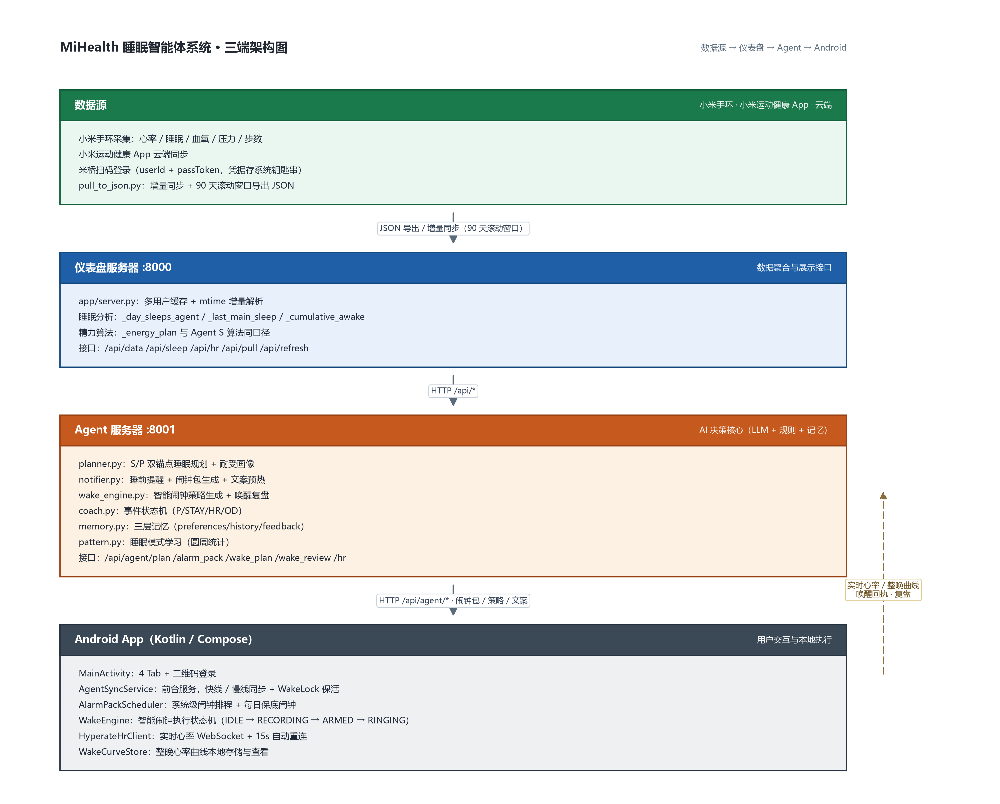

# MiHealth 睡眠智能体系统 · 系统设计

> 版本：v2.0
> 日期：2026-10-20
> 作者：Sharkkkkkkkll

## 1. 总体架构

系统采用「三端分离」架构：

``


## 2. 模块设计

### 2.1 数据采集层（米桥 + pull_to_json.py）

**职责**：从小米云端拉取健康数据，导出为 JSON。

**关键设计**：
- 扫码登录：`mijiaAPI().login()` 获取 userId + passToken
- 增量同步：首次全量 90 天，后续 `today-7` 重叠窗
- 滚动窗口：`export_database(..., start_date=today-89, end_date=today)`
- 多用户：`mi_fitness_local_<uid>.db` + `JSON/<uid>/` 隔离
- 幂等：upsert 不重复，`--force-full` 强制全量

**关键文件**：
- `D:\MIwatchAI\pull_to_json.py`
- `D:\WORKBUDDY\tools\mi_fitness_data_bridge\`

### 2.2 仪表盘服务器（app/server.py，:8000）

**职责**：读取最新 JSON，聚合数据供 App 展示。

**关键设计**：
- mtime 缓存：JSON 文件没变就不重新解析
- 多用户缓存：按 user_id 分 key
- 精力算法：`_energy_plan` 与 Agent S 算法同口径
- 睡眠分析：`_day_sleeps_agent` / `_last_main_sleep` / `_cumulative_awake`

**接口**：

| 接口 | 方法 | 说明 |
|---|---|---|
| `/api/data` | GET | 聚合数据（步数/睡眠/心率/血氧/压力） |
| `/api/sleep` | GET | 睡眠总览/单日 |
| `/api/hr` | GET | 全天心率详情 |
| `/api/pull` | GET | 触发数据拉取（按 user_id） |
| `/api/pull_status` | GET | 拉取状态（按 user_id 独立） |
| `/api/refresh` | GET | 强制刷新缓存 |

### 2.3 Agent 服务器（Agent/agent_server.py，:8001）

**职责**：AI 决策核心，处理睡眠规划、提醒生成、智能闹钟策略。

**关键设计**：
- 调度线程：窗口外 5 分钟一拍，窗口内 20 秒一拍
- 启动恢复：`_startup_recovery()` 启动时立即恢复计划/闹钟包/文案
- 多用户：`config.list_users()` 遍历所有用户
- 幂等保护：`maybe_generate` / `get_or_build_pack` / `pregen_due` 都有去重

**接口**：

| 接口 | 方法 | 说明 |
|---|---|---|
| `/api/agent/ping` | GET | 连通性自检 |
| `/api/agent/chat` | GET/POST | 对话（注入健康快照+记忆） |
| `/api/agent/plan` | GET | 获取今晚计划 |
| `/api/agent/plan_now` | POST | 立即规划 |
| `/api/agent/alarm_pack` | GET | 获取闹钟包 |
| `/api/agent/pregen_next` | POST | 生成下一条文案 |
| `/api/agent/wake_plan` | POST | 生成智能闹钟策略 |
| `/api/agent/wake_review` | POST | 唤醒复盘 |
| `/api/agent/preferences` | POST | 推送作息目标/授权 |
| `/api/agent/feedback` | POST | 反馈 |
| `/api/agent/screen` | POST | 屏幕状态上报 |
| `/api/agent/hr` | POST | 实时心率上报 |
| `/api/agent/alarm_ack` | POST | 闹钟排程回执 |
| `/api/agent/qr_login` | GET | 二维码登录 |
| `/api/agent/qr_status` | GET | 扫码状态 |

### 2.4 Android App（D:\work\mihealth_app）

**职责**：用户交互、系统闹钟、实时心率、智能闹钟执行。

**关键模块**：

| 文件 | 职责 |
|---|---|
| `MainActivity.kt` | 4 Tab + 二维码登录 |
| `AgentSyncService.kt` | 前台服务，快线/慢线同步，WakeLock 保活 |
| `AlarmPackScheduler.kt` | 系统级闹钟排程 + 保底闹钟 |
| `WakeEngine.kt` | 智能闹钟执行状态机 |
| `BleHrClient.kt` | BLE 直连手环心率（GATT 订阅） |
| `HrForegroundService.kt` | 心率保活前台服务（WakeLock/WifiLock） |
| `WakeCurveStore.kt` | 整晚心率曲线本地存储 |
| `MoreScreen.kt` | 更多页（睡眠目标/提醒/智能闹钟/心率广播） |

### 2.5 BLE 心率直连（BleHrClient.kt + HrForegroundService.kt）

**职责**：App 通过标准蓝牙 GATT 协议直接读取手环实时心率，替代第三方心率广播 App。

**关键设计**：
- 标准服务：`0x180D` 心率服务 / `0x2A37` 心率测量特征 / `0x2A39` 控制点 / `0x2902` CCCD
- 连接链路：`connectGatt` → `discoverServices` → 订阅通知 → 写 CCCD → 尝试写控制点 → 解析心率
- `autoConnect=true`：断线后蓝牙栈自动重连，适配整晚锁屏场景
- 重连退避：5s 起步、翻倍、封顶 30s
- 前台服务保活：`connectedDevice` 前台服务 + `PARTIAL_WAKE_LOCK` + `WIFI_MODE_FULL_HIGH_PERF` WifiLock
- 假死检测：20s 周期检查，心率中断超过 90s 强制重连
- 全量记录：心率广播开关开着就全量记录带时间戳的心率曲线，AI 后续自己取窗口段
- 窗口内上报节流：10s 一次，避免刷爆 Agent 服务器

**关键文件**：
- `BleHrClient.kt`
- `HrForegroundService.kt`
- `WakeCurveStore.kt`

## 3. 核心算法设计

### 3.1 睡眠规划（planner.py）

**双锚点模型**：

```
S（生理困意）= 醒来 + 今天清醒时长（比例+质量系数缩放）
P（计划睡眠）= 起床硬约束 − 理想睡眠时长
推荐区间 = 以 S 为基准，受 early/late 耐受画像约束
```

**决策流程**：
1. 规则引擎算候选值（S/P/区间/护栏）
2. LLM 判断今晚情景（正常/负债/质量差/硬事夜）
3. LLM 输出分层建议（ideal/fallback/in_bed_by）
4. 越界校验：不得早于 lo，最多晚于 hi+15，不得突破起床护栏
5. LLM 失败 → 退回规则中心值

### 3.2 睡前提醒（notifier.py）

**闹钟包结构**：

```json
{
  "date": "2026-10-17",
  "bedtime": "01:27",
  "bed_min": 87,
  "version": 1792170488,
  "items": [
    {"event": "P60", "lead_min": 60, "at": "00:27", "at_ts": ...},
    {"event": "P40", "lead_min": 40, "at": "00:47", "at_ts": ...},
    ...
  ]
}
```

**文案生成**：
- 弹前 5 分钟生成 AI 文案（就近优先，只生成 1 条）
- 池子预热 + `_REFILLING` 防重入
- LLM 失败 → 本地模板兜底
- 生成完 → `pack_update` 通知手机拉包重定

### 3.3 智能闹钟（wake_engine.py + WakeEngine.kt）

**策略类型**：

| 策略 | 触发条件 |
|---|---|
| light_sleep_early/mid/late | 浅睡前期/中期/后期 |
| rem | 快速眼动期 |
| deep_protect | 深睡保护 |
| deep_end_light | 深睡结束浅睡 |
| near_fallback | 窗口内无浅睡接近保底 |
| window_start_light | 窗口开始即浅睡 |
| hr_abnormal | 心率异常 |
| fallback_only | 保底时刻 |

**执行状态机**：

```
IDLE → RECORDING → WAITING_PLAN → ARMED → RINGING → CONFIRMING → DONE
```

**硬边界**：
- 窗口开始前绝不叫
- 窗口结束保底响过之后绝不叫

## 4. 数据流

### 4.1 睡前提醒链路

```
手机设置入睡时间/开 AI
  → pushSleepGoal / plan_now
  → Agent 生成今晚计划
  → get_or_build_pack 生成闹钟包
  → push pack_update
  → 手机快线拉包 → setAlarmClock 排闹钟
  → 弹前 5 分钟 pregen_due 生成 AI 文案
  → 手机响铃
```

### 4.2 智能闹钟链路

```
入睡时间前 10 分钟 → WakeEngine 开始记录心率曲线
  → 起床窗口前 10 分钟 → 上传曲线给 Agent
  → Agent 生成 wake_pack → 下发手机
  → 窗口开始 → ARMED（本地监测心率）
  → 浅睡/REM 信号 → 渐进式响铃
  → 深睡保护/保底 → 响铃
  → 唤醒后 → 上传完整曲线复盘
```

## 5. 多用户隔离

### 5.1 数据隔离

| 维度 | 隔离方式 |
|---|---|
| 记忆 | `memory_data/<user_id>/` |
| 数据源 | `JSON/<user_id>/` |
| 数据库 | `mi_fitness_local_<uid>.db` |
| 钥匙串 | `mi_fitness_auth_<uid>_*` |
| 拉取进程 | `_pull_proc[user_id]` 独立进程 |
| 拉取状态 | `/api/pull_status?user_id=xxx` 独立状态 |
| 数据缓存 | `data_source` 缓存按用户分 key |
| LLM 用量日志 | `memory_data/<user_id>/usage_log.jsonl` |

### 5.2 请求级隔离

- 所有仪表盘接口支持 `?user_id=xxx`，空值兼容单用户根目录
- 所有 Agent 接口从 URL query 和 POST body 同时解析 `user_id`
- `data_source` 当前用户用 `threading.local()`，并发请求不串用户
- 后台调度线程按 `config.list_users()` 遍历所有用户，每个用户独立跑规划/提醒/唤醒
- 后台子线程全部显式传 `user_id`，不依赖线程上下文

### 5.3 登录流程

```
首次启动 → 二维码登录（米家 App 扫码）
  → 获取 userId → 存本地
  → 后续所有请求带 user_id
  → 跳过 = 单用户模式（读根目录）
```

### 5.4 多设备隔离

- 每台手机扫码登录各自小米账号，服务端按 `user_id` 区分
- 同一小米账号多台设备 = 同一套数据（`user_id` 相同）
- 妈妈手机登录妈妈账号，只会拉取/显示妈妈的数据
- 服务端重启后需各账号重新扫码确认 token 入库

## 6. 可靠性设计

### 6.1 闹钟可靠性

- 系统级 `setAlarmClock`：App 被杀也响
- 保底闹钟：设置起床时间时排好，每天重复
- 正常浅睡叫醒后取消保底，防双响
- 保底响后自动排明天

### 6.2 Agent 可靠性

- LLM 失败 → 规则中心值兜底
- 启动恢复：立即恢复计划/闹钟包/文案
- 幂等保护：不重复生成、不重复重建
- 数据读取重试：JSON 写一半时重试

### 6.3 心率可靠性

- BLE 直连 + `autoConnect=true` 系统级重连
- 前台服务 + `PARTIAL_WAKE_LOCK` + WifiLock 保活
- 20s 假死检测 + 90s 强制重连
- 5s-30s 指数退避重连
- 心率断连 → 保底闹钟兜底

## 7. 安全设计

- 凭据存系统钥匙串，不落盘明文
- `get_profile` 返回脱敏 account_id
- 导出文件权限控制（POSIX 0600）
- CSV 公式注入防护
- 二维码登录凭据不写入 shell 历史

---

*本文档基于实际代码实现编写，所有模块均可追溯至代码。*
